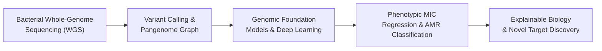

# OmicGene: Advancing Computational Genomics & Antimicrobial Resistance Intelligence

<div align="center">

```
   ____            _       ____                  
  / __ \____ ___  (_)____ / ___| ___ _ __   ___  
 / / / / __ `__ \/ / ___// / __ / _ \ '_ \ / _ \ 
/ /_/ / / / / / / / /__ / /_/ /  __/ / / /  __/ 
\____/_/ /_/ /_/_/\___/ \____/ \___/_/ /_/\___/  
                                                 
Precision Genomic Intelligence & AI-Driven Antimicrobial Resistance Discovery
```

[](https://github.com/omicgene)
[](https://github.com/omicgene)
[](https://www.go-fair.org/fair-principles/)
[](LICENSE)

</div>

---

### 🌐 Welcome to the OmicGene Research Organization

**OmicGene** is an open-source scientific organization dedicated to solving critical global health challenges at the intersection of **computational genomics, bioinformatics, and machine learning**.

Our flagship initiative tackles **Antimicrobial and Antimycobacterial Resistance (AMR)**—one of the World Health Organization’s top global health threats. By uniting high-throughput bacterial whole-genome sequencing (WGS), pangenome graph architectures, and deep neural representations, OmicGene empowers researchers and clinical microbiologists to decode the mechanisms of drug resistance with unprecedented accuracy.

---

### 🔬 Core Research Pillars



1. **Antimicrobial & Antimycobacterial Resistance (AMR)**:
   - Decoding single nucleotide polymorphisms (SNPs), structural variants, and promoter mutations in pathogens such as *Mycobacterium tuberculosis*, *Staphylococcus aureus*, *Klebsiella pneumoniae*, and *Pseudomonas aeruginosa*.
   - Direct-from-sequence Minimum Inhibitory Concentration (MIC) quantitative regression.

2. **Large-Scale Genomic Foundation Models**:
   - Pre-training protein and genomic sequence language models (ESM, Nucleotide Transformer, HyenaDNA) on bacterial pangenomes.
   - Graph Neural Networks (GNNs) on bacterial metabolic networks and protein-protein interaction (PPI) networks.

3. **Benchmarking & Scientific Reproducibility**:
   - Rigorous empirical evaluation against international standard datasets (CRyPTIC 10k isolates, CARD, ResFinder, BV-BRC, NCBI Pathogen Detection).
   - Adherence to the **FAIR** principles: Findable, Accessible, Interoperable, and Reusable.

---

### 📦 Key Repositories & Initiatives

| Repository | Description | Status |
| :--- | :--- | :--- |
| **[`omicgene/omicgene`](https://github.com/omicgene/omicgene)** | Core repository: Deep learning architectures, variant pipelines, and curated AMR literature. | Active 🚀 |
| **[`omicgene/amr-benchmarks`](https://github.com/omicgene)** | Standardized benchmarking suites across 15+ first- and second-line antimicrobials. | Planned 📋 |
| **[`omicgene/pangenome-graphs`](https://github.com/omicgene)** | Variation graph construction and k-mer indexing for bacterial pan-resistance catalogs. | Research 🔬 |

---

### 🤝 Join the Research Community

We actively invite bioinformaticians, clinical microbiologists, machine learning researchers, and software engineers to collaborate.

- **Discussion Forum**: [Join OmicGene Discussions](https://github.com/omicgene/omicgene/discussions)
- **Contribution Guide**: Read our [Contributing Guidelines](https://github.com/omicgene/omicgene/blob/main/CONTRIBUTING.md)
- **Scientific Steering**: Contact us at [darrehanrasool@gmail.com](mailto:darrehanrasool@gmail.com)
