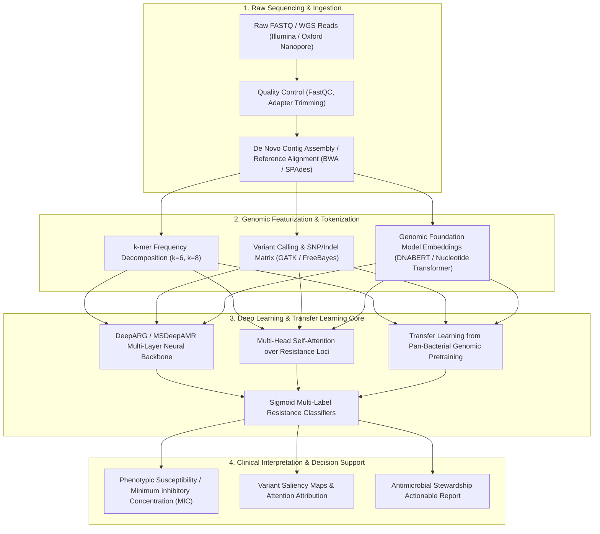

# omicgene

Computational genomics, machine learning, and deep learning for antimicrobial and antimycobacterial resistance (AMR).

---

## 🔬 Problem Statement & Genomic Research Objective

### The Antimicrobial Resistance (AMR) Global Health Crisis
Antimicrobial resistance is recognized by the World Health Organization (WHO) as one of the top ten global public health threats facing humanity. Traditional culture-based phenotypic antimicrobial susceptibility testing (AST) requires 24 to 72 hours (and weeks for slow-growing pathogens like *Mycobacterium tuberculosis*). High-throughput Whole-Genome Sequencing (WGS) and metagenomic sequencing offer the potential for rapid, comprehensive resistance diagnosis, but mapping raw genetic variation to phenotypic resistance is hindered by polygenic epistatic interactions, novel uncatalogued mutations, and non-coding regulatory variants:
$$f: \mathcal{S} \in \{A, C, G, T\}^L \xrightarrow{\text{WGS / Metagenome}} \mathbf{y} \in \{0, 1\}^K \quad (\text{Susceptibility/Resistance across } K \text{ Antibiotics})$$

### Core Scientific & Engineering Objectives
1. **Sequence Representation Learning:** Move beyond rigid rule-based resistance catalogs (e.g., PointFinder, ResFinder) toward continuous representation learning via genomic language models and deep neural networks.
2. **K-mer & Attention Modeling:** Discretize continuous microbial contigs into variable-length nucleotide tokens ($k$-mers) and apply self-attention to identify distal epistatic interactions and promoter mutations.
3. **Metagenomic Resistance Gene Discovery:** Classify fragmented reads from polymicrobial clinical samples directly into antibiotic classes and resistance mechanisms (e.g., enzymatic degradation, target alteration, efflux pumps).
4. **Interpretable Mechanistic Variant Attribution:** Trace model predictions back to specific nucleotide loci and amino acid substitutions to inform clinical microbiological stewardship.

---

## 📐 Genomic System Architecture & ML/Bioinformatics Pipeline Flow

---

## 🌐 Interactive Visualizers & ML Engineering Conceptualization (The 16 Tools)

To conceptualize genomic tokenization, high-dimensional sequence embeddings, attention over long DNA contigs, and statistical significance in resistance detection, leverage these canonical interactive tools:

| Domain & Tool | Interactive Visualizer Link | Direct Application to Omicgene Architecture & Flow |
|---|---|---|
| **Genomic Sequence Tokenization** | [Tiktokenizer](https://tiktokenizer.vercel.app/) | **k-mer & BPE Tokenization:** Analyze tokenization dynamics, vocabulary size trade-offs, and context compression when encoding nucleotide strings ($A, C, G, T$) into sub-word tokens for genomic transformers. |
| **Bacterial Strain & Gene Embedding Space** | [TensorFlow Embedding Projector](https://projector.tensorflow.org/) | **High-Dimensional Genomic Projections:** Project whole-genome embeddings (from DNABERT or k-mer distributions) into 3D using UMAP/t-SNE to visualize the phylogenetic clustering of resistant vs susceptible bacterial clades. |
| **Attention over Long Genomic Contigs** | [Sebastian Raschka's Attention Guide](https://magazine.sebastianraschka.com/p/visual-attention-variants) | **Long-Context Attention Variants:** Evaluate FlashAttention, sliding-window attention, and Ring Attention architectures capable of processing multi-hundred-kilobase bacterial chromosomes without quadratic memory explosions. |
| **Genomics Dataset Exploration** | [HF Viewer](https://hfviewer.com/) | **WGS & Metagenomic Metadata Preview:** Rapidly inspect open-source microbial genomics datasets, AMR metadata annotations, and clinical MIC distribution tables without heavy local storage overhead. |
| **Transformer Forward Pass in Sequence Models** | [LLM Visualization by Brendan Bycroft](https://bbycroft.net/llm) | **DNA Sequence Transformer Geometry:** Visualize tensor transformations, token embeddings, and multi-head attention blocks operating on biological sequence inputs. |
| **Mechanistic Motif Attribution** | [Neuronpedia](https://www.neuronpedia.org/) | **Resistance Motif Attribution:** Understand how individual attention heads and hidden neurons correlate with specific conserved functional resistance sequences (e.g. beta-lactamase active sites, quinolone resistance-determining regions). |
| **High-Throughput Clinical Sequencing Serving** | [Modular LLM Inference Handbook](https://handbook.modular.com/llm-inference-basics/what-is-llm-inference/) | **Bedside Diagnostics Latency:** Systems engineering guide for optimizing GPU memory bandwidth and inference latency during real-time basecalling and continuous streaming metagenomic profiling. |
| **Non-Linear Phenotype Boundaries** | [TensorFlow Playground](https://playground.tensorflow.org/) | **Multi-Locus Epistatic Interactions:** Visualize how multi-layer neural architectures capture complex non-linear combinations of genetic mutations that collectively confer high-level resistance. |
| **Statistical Genomics & Odds Ratios** | [Seeing Theory (Brown University)](https://seeing-theory.brown.edu/) | **Genome-Wide Significance & Fisher's Exact:** Conceptualize p-value adjustments, false discovery rates (FDR), and odds ratios in microbial genome-wide association studies (GWAS). |
| **Multi-Label Evaluation Curves** | [MLU-Explain](https://mlu-explain.github.io/) | **Imbalanced Resistance Evaluation:** Examine Precision-Recall curves and ROC/AUC metrics over sparse multi-label distributions where specific resistance phenotypes are rare. |
| **Dimensionality Reduction Intuition** | [Explained Visually (Setosa PCA)](https://setosa.io/ev/pca/) | **Principal Component Analysis on Genomic Variants:** Geometric understanding of how PCA reduces thousands of sparse SNP markers into major population structure components. |
| **PyTorch Autograd & Sequence Models** | [Karpathy's Zero to Hero](https://karpathy.ai/zero-to-hero.html) | **Code-First Biological Modeling:** Reference for implementing custom character-level language models, cross-entropy loss functions, and backpropagation for DNA sequences. |

---

## 🛠️ My Work: Key Scientific & Engineering Contributions

* **Curated AMR Literature Repository:** Synthesized and organized a curated literature library (2015–2025) of landmark studies covering transfer learning, deep neural networks (MSDeepAMR, DeepARG), and whole-genome sequencing in antimicrobial resistance under the mentorship of Prof. Aasif Assad.
* **Genomic Architecture Formulation:** Designed the theoretical and computational architecture for sequence-based resistance modeling, translating raw sequencing data into multi-label phenotypic resistance predictions.
* **Comparative Bioinformatics Benchmarking:** Formulated benchmarking protocols comparing alignment-free k-mer tokenization vs foundation model embeddings for antimicrobial susceptibility classification.
* **Open-Source Scientific Repository:** Structured and maintained the `omicgene` open-source codebase, ensuring strict compliance with open science standards, Zenodo citable DOI indexing, and academic reproducibility guidelines.

---

## 🚀 Future Work & Research Roadmap

1. **Bacterial Pangenome Foundation Model:** Train a self-supervised foundation transformer across hundreds of thousands of bacterial isolate genomes to learn universal regulatory and coding grammar.
2. **Nanopore Real-Time Adaptive Sampling:** Interface neural resistance models with Oxford Nanopore's ReadUntil API to dynamically reject non-pathogenic DNA and selectively sequence antibiotic resistance genes in real-time.
3. **Structural Protein Co-Folding for Mutational Impact:** Integrate AlphaFold 3 / Boltz-2 protein-ligand co-folding into the prediction loop to model how novel target mutations physically alter antibiotic binding affinity (e.g. Rifampicin binding to RNA polymerase).
4. **Metagenomic Wastewater Surveillance Pipeline:** Deploy an automated streaming bioinformatics pipeline to monitor community-level antimicrobial resistance emergence from municipal metagenomic sequencing.

---

## Overview

Welcome to **omicgene**! This repository is dedicated to advancing computational genomics and machine learning methods to combat antimicrobial resistance.

- 📚 [Research Literature Library](papers/INDEX.md) — Curated collection of milestone studies (2015–2025)
- 🎓 [Prof. Aasif Assad Curated Collection](papers/aasif-assad/INDEX.md) — 5 foundational papers on AI/ML for AMR
- 🤝 [Contributing Guidelines](CONTRIBUTING.md) — How to contribute code, models, and literature
- 📜 [Code of Conduct](CODE_OF_CONDUCT.md) — Our community standards and commitments
- 🔒 [Security Policy](SECURITY.md) — Vulnerability reporting and data guidelines

## Curated Research Literature (Prof. Aasif Assad Collection)

Curated research papers exploring AI, deep neural networks, and whole-genome sequencing in predicting and combating antimicrobial resistance (AMR):

1. **[MSDeepAMR: antimicrobial resistance prediction based on deep neural networks and transfer learning](https://www.frontiersin.org/journals/microbiology/articles/10.3389/fmicb.2024.1361795/full)**  
   *Frontiers in Microbiology* (2024) | [`PDF Document`](papers/aasif-assad/2024_MSDeepAMR_TransferLearning_Frontiers.pdf)
2. **[The role of artificial intelligence and machine learning in predicting and combating antimicrobial resistance](https://spj.science.org/doi/full/10.1016/j.csbj.2025.01.006)**  
   *Computational and Structural Biotechnology Journal* (2025) | [`PDF Document`](papers/aasif-assad/2025_AI_ML_PredictingCombatingAMR_CSBJ.pdf)
3. **[DeepARG: a deep learning approach for predicting antibiotic resistance genes from metagenomic data](https://link.springer.com/article/10.1186/s40168-018-0401-z)**  
   *Microbiome* (2018) | [`PDF Document`](papers/aasif-assad/2018_DeepARG_MetagenomicAMR_Microbiome.pdf)
4. **[Prediction of antimicrobial resistance based on whole-genome sequencing and machine learning](https://academic.oup.com/bioinformatics/article/38/2/325/6382301)**  
   *Bioinformatics* (2022) | [`PDF Document`](papers/aasif-assad/2022_Ren_WGS_MachineLearningAMR_Bioinformatics.pdf)
5. **[Artificial intelligence in predicting pathogenic microorganisms’ antimicrobial resistance: challenges, progress, and prospects](https://www.frontiersin.org/journals/cellular-and-infection-microbiology/articles/10.3389/fcimb.2024.1482186/full)**  
   *Frontiers in Cellular and Infection Microbiology* (2024) | [`PDF Document`](papers/aasif-assad/2024_AI_PredictingPathogenAMR_Frontiers.pdf)

## Contributors

Thank you to everyone contributing to the development and maintenance of **omicgene**:

- [Dar Rehan Rasool](https://github.com/darrehanrasool)
- [Shafiya Bashir](https://github.com/shafiyabashirpampori)
