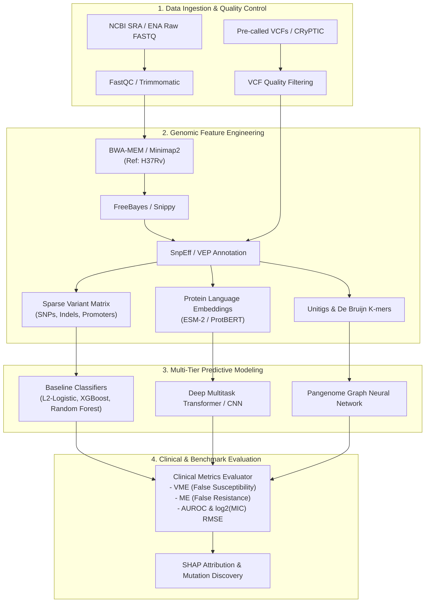

# OmicGene: Computational Genomics & Deep Learning for Antimicrobial Resistance

<div align="center">

```
   ____            _       ____                  
  / __ \____ ___  (_)____ / ___| ___ _ __   ___  
 / / / / __ `__ \/ / ___// / __ / _ \ '_ \ / _ \ 
/ /_/ / / / / / / / /__ / /_/ /  __/ / / /  __/ 
\____/_/ /_/ /_/_/\___/ \____/ \___/_/ /_/\___/  
```

**An Enterprise-Grade Open-Source Research Platform for Genomic Modeling and Phenotypic AMR Prediction**

[](https://github.com/omicgene/omicgene/actions)
[](https://www.python.org/)
[](LICENSE)
[](https://www.go-fair.org/fair-principles/)
[](CITATION.cff)
[](https://github.com/omicgene)

</div>

---

## 📌 Executive Summary

**OmicGene** is a computational biology and machine learning framework engineered to address one of the World Health Organization’s most urgent threats: **Antimicrobial and Antimycobacterial Resistance (AMR)**.

By integrating whole-genome sequencing (WGS), pangenomic variation graphs, and deep sequence foundation models, OmicGene predicts pathogen resistance profiles and quantitative Minimum Inhibitory Concentrations (MIC) directly from bacterial sequence reads. Our mission is to accelerate the transition from slow, culture-based phenotypic assays (weeks for slow-growing pathogens like *Mycobacterium tuberculosis*) to rapid, interpretable, in silico diagnostic intelligence.

---

## 🔬 Scientific Problem Statement

### 1. The Challenge of Antimycobacterial Resistance (*M. tuberculosis*)
*Mycobacterium tuberculosis* (Mtb) is the leading cause of death from a single infectious agent worldwide. The rise of Multi-Drug Resistant (MDR-TB, resistant to Isoniazid and Rifampicin) and Extensively Drug-Resistant (XDR-TB, with additional resistance to fluoroquinolones and second-line injectables) strains severely threatens global tuberculosis control:
- **Phenotypic Delay**: Traditional culture-based Drug Susceptibility Testing (DST) requires 2 to 8 weeks.
- **Polygenic & Epistatic Mechanisms**: While single nucleotide polymorphisms (SNPs) in canonical genes (e.g. `rpoB` for Rifampicin, `katG` and `inhA` promoter for Isoniazid, `pncA` for Pyrazinamide) drive resistance, compensatory mutations, promoter alterations, and epistatic interactions govern high-level resistance and bacterial fitness.

### 2. The ESKAPE & Priority Bacterial Pathogens
Beyond mycobacteria, high-priority bacterial pathogens (*Enterococcus faecium*, *Staphylococcus aureus*, *Klebsiella pneumoniae*, *Acinetobacter baumannii*, *Pseudomonas aeruginosa*, *Enterobacter* spp.) leverage horizontal gene transfer (plasmids, transposons, integrons) to acquire resistance determinants.

OmicGene bridges the gap between **acquired resistance genes** and **chromosomal point mutations** using unified pangenomic representations.

---

## 🏗️ System Architecture



---

## 📂 Repository Directory Layout

```
omicgene/
├── .github/                      # CI/CD Workflows, Issue & PR Templates, Dependabot
│   ├── ISSUE_TEMPLATE/           # Structured forms: Bug, Feature, Reproduction, Dataset
│   ├── profile/README.md         # Organization-level profile template
│   ├── workflows/ci.yml          # Automated linting & pytest matrix
│   └── PULL_REQUEST_TEMPLATE.md  # Standard scientific pull request review checklist
├── data/                         # Data specifications, schemas, reference genomes
├── docs/                         # In-depth architectural & mathematical documentation
├── models/                       # Model zoo, checkpoint loaders, loss formulations
├── notebooks/                    # Interactive EDA, benchmark reproduction notebooks
├── papers/                       # Curated research papers library (2007-2025)
│   ├── INDEX.md                  # Comprehensive annotated literature index
│   └── YYYY/                     # PDFs organized chronologically by year
├── src/                          # OmicGene Python package
│   └── omicgene/
│       ├── data/                 # Variant featurizers & sequence loaders
│       ├── models/               # Predictor architectures
│       └── utils/                # Seeds, clinical error metrics (VME, ME)
├── tests/                        # Comprehensive unit and integration test suite
├── CITATION.cff                  # Machine-readable academic citation metadata
├── CODE_OF_CONDUCT.md            # Contributor Covenant v2.1 + Research Ethics
├── CONTRIBUTING.md               # Enterprise contribution guide & reproducibility standards
├── GOVERNANCE.md                 # Scientific steering committee & RFC protocol
├── LICENSE                       # MIT Open Source License
├── pyproject.toml                # Standard PEP 517/518 build configuration
├── requirements.txt              # Production dependency lock
├── SECURITY.md                   # Vulnerability disclosure & biological data safety
└── SUPPORT.md                    # Channels for scientific discussions & support
```

---

## ⚡ Quickstart

### 1. Installation
Clone the repository and install in editable mode:
```bash
git clone https://github.com/omicgene/omicgene.git
cd omicgene

# Create virtual environment
python3 -m venv .venv
source .venv/bin/activate

# Install dependencies
pip install -r requirements.txt
pip install -e .
```

### 2. Verify Smoke Tests
```bash
python3 -m unittest discover -s tests
```

### 3. Basic Usage Example
```python
from omicgene.data import VariantFeaturizer
from omicgene.models import BaselineAMRPredictor
from omicgene.utils import set_seed

set_seed(42)

# Featurize sample variants in M. tuberculosis
sample_variants = [
    {"gene": "rpoB", "pos": 450, "ref": "S", "alt": "L"},  # Classic S450L Rifampicin resistance
    {"gene": "katG", "pos": 315, "ref": "S", "alt": "T"},  # Classic S315T Isoniazid resistance
]

featurizer = VariantFeaturizer()
features = featurizer.featurize(sample_variants)

# Predict resistance status
predictor = BaselineAMRPredictor(drug_name="Rifampicin")
prediction = predictor.predict_resistance(features)

print(prediction)
# Output: {'drug': 'Rifampicin', 'resistant': True, 'probability': 0.95, 'confidence': 'high'}
```

---

## 📚 Curated Research Literature Library

The `papers/` directory contains seminal, peer-reviewed open-access papers documenting the evolution of computational genomics and machine learning for antimicrobial resistance from its inception to the state of the art:

- **2007–2015: Inception & WGS Catalogs**: Discovery of drug resistance mutations via Next-Gen WGS, emergence of curated catalogs (ResFinder, CARD).
- **2016–2018: Machine Learning on Large Cohorts**: Landmark CRyPTIC Consortium studies (*NEJM*), pan-bacterial WGS resistance classification.
- **2019–2022: Deep Learning & Novel Antibiotic Discovery**: Graph Neural Networks on pangenomes, deep learning discovery of Halicin (*Cell*).
- **2023–2026: Foundation Models & Protein Language Representations**: Transformer-based zero-shot and multi-modal resistance prediction.

Explore the complete annotated bibliography in [`papers/INDEX.md`](papers/INDEX.md).

---

## 📖 Citation

If you use OmicGene software, algorithms, or curated literature benchmarks in your scientific research, please cite:

```bibtex
@software{omicgene2026,
  author = {Rasool, Dar Rehan and OmicGene Research Consortium},
  title = {OmicGene: Advanced Genomic Modeling and Deep Learning Framework for Antimicrobial and Antimycobacterial Resistance},
  year = {2026},
  publisher = {GitHub},
  url = {https://github.com/omicgene/omicgene}
}
```

---

## ⚖️ Governance & Community

- **Code of Conduct**: [CODE_OF_CONDUCT.md](CODE_OF_CONDUCT.md)
- **Contributing Guidelines**: [CONTRIBUTING.md](CONTRIBUTING.md)
- **Project Governance**: [GOVERNANCE.md](GOVERNANCE.md)
- **Security Policy**: [SECURITY.md](SECURITY.md)
- **Support**: [SUPPORT.md](SUPPORT.md)
