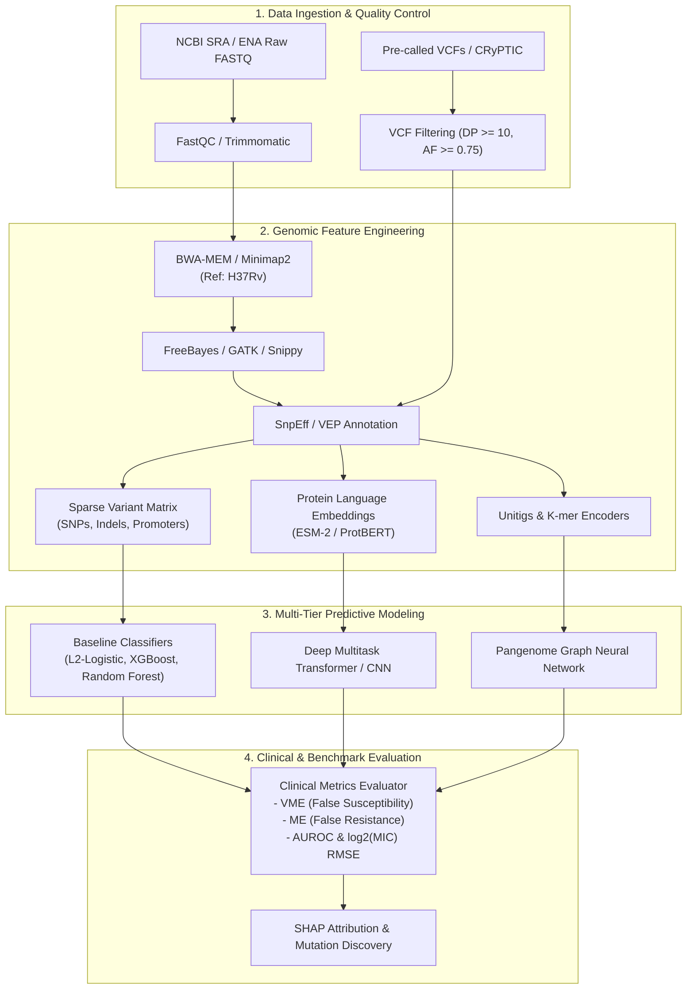

# OmicGene System Architecture

---

## Technical Specifications

1. **Alignment & Reference**:
   - For *Mycobacterium tuberculosis*, reads are aligned to the H37Rv reference genome (`NC_000962.3`).
   - Repetitive regions (PPE/PE-PGRS gene families) and mobile genetic elements are flagged to avoid false-positive variant calls.
2. **Phenotypic Targets**:
   - First-line anti-TB agents: Isoniazid (INH), Rifampicin (RIF), Ethambutol (EMB), Pyrazinamide (PZA).
   - Second-line fluoroquinolones: Moxifloxacin (MFX), Levofloxacin (LFX), Ofloxacin (OFX).
   - Second-line injectables: Amikacin (AMI), Kanamycin (KAN), Capreomycin (CAP).
   - Novel/repurposed: Bedaquiline (BDQ), Linezolid (LZD), Clofazimine (CFZ), Delamanid (DLM).
3. **Loss Functions**:
   - Combined multi-task objective:
     $$\mathcal{L} = \alpha \mathcal{L}_{\text{BCE}}(\hat{y}_{\text{class}}, y_{\text{class}}) + (1 - \alpha) \mathcal{L}_{\text{Huber}}(\hat{y}_{\text{MIC}}, y_{\text{MIC}})$$
     where $\alpha$ is a dynamic balancing hyperparameter.
